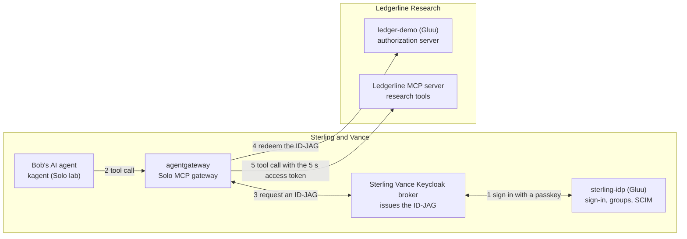
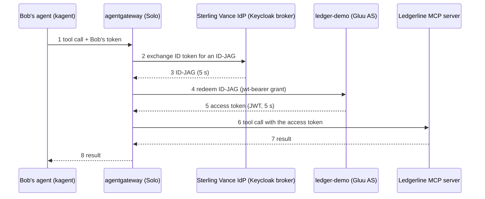

# AI Agent Authorization with ID-JAG: Gluu + Solo.io Interop (Technical Doc)

Last updated 2026-10-12 · Author: Mohib Zico

## Summary

We built and tested a flow where a user's AI agent reaches a service at another company without a second login, using the IETF ID-JAG grant on two Gluu (Janssen) servers and Solo.io's agentgateway as the MCP gateway. Solo's end-to-end run on 2026-10-10 succeeded: Bob signed in with a passkey, his agent called the Ledgerline service through the gateway, and the service accepted a 5-second access token issued by `ledger-demo`.

- **Why:** the OpenID Foundation AIIM Community Group is running an interoperability event on securing MCP (Model Context Protocol) flows with open identity standards. Results are presented at the Gartner IAM Summit, Las Vegas, December 7-9, 2026. The first successful cross-partner test was due October 16, 2026.
- **What the agent never holds:** Bob's access token, his ID token, or the ID-JAG. The gateway obtains and uses them, each for seconds.
- **Servers:** `sterling-idp.gluu.info` (new, Sterling & Vance's login server) and `ledger-demo.gluu.info` (Ledgerline's authorization server). Solo's lab provides the gateway, the agent and a Keycloak broker.
- **Open points:** a Janssen limitation (ID-JAG signatures are checked only with the server's own keys), worked around with a keystore import. A few claims are configured but not yet confirmed with a live login. See Open items.

## Background

The flow combines four standards: MCP (how agents call tools), OAuth 2.1 (how access is granted), CIMD (how a client names itself) and ID-JAG (how one company vouches for a user to another).

| Term | What it is | Role in this project |
| --- | --- | --- |
| MCP (Model Context Protocol) | Protocol for AI agents to call tools and data on a server | The Ledgerline research server is an MCP server. The gateway acts as an MCP client toward it and an MCP server toward the agent. |
| OAuth 2.1 and PKCE | Authorization framework. PKCE (S256) binds an authorization code to the client that asked for it | Required for the code flows. Discovery must advertise `code_challenge_methods_supported`. |
| CIMD (Client ID Metadata Document) | A client uses an HTTPS URL as its `client_id`. The server fetches the metadata from that URL | Lets an agent identify itself without pre-registration. Works on `ledger-demo` after two bug patches. |
| Token exchange (RFC 8693) | Swap one token for another at the token endpoint | The IdP exchanges Bob's ID token for an ID-JAG. |
| ID-JAG (Identity Assertion JWT Authorization Grant) | A signed, short-lived JWT, header `typ` `oauth-id-jag+jwt`. Names the user (`sub`), the target authorization server (`aud`), the requesting client (`client_id`) and the scope | The "I vouch for this user" letter from the user's company to another company. |
| JWT bearer grant (RFC 7523) | Present a signed JWT as the grant at the token endpoint | How `ledger-demo` redeems the ID-JAG. |
| MCP Enterprise-Managed Authorization (EMA) | MCP extension that uses ID-JAG so the enterprise IdP, not each user, approves access to an MCP server | The OpenID event's name for this flow. |
| MCP gateway | Component between agents and tools. Checks callers, fetches tokens, enforces policy | Solo's agentgateway. |

Three roles recur below. The **IdP** knows the user and issues the ID-JAG. The **authorization server (AS)** verifies it and issues the access token. The **gateway** carries tokens between them so the agent never holds them.

## Architecture and flow

Two companies meet at the gateway: S&V's IdP vouches for Bob, and Ledgerline's authorization server turns that into a 5-second access token that only the gateway holds.

### Who talks to whom

The agent only talks to the gateway (2). The gateway asks the IdP side for the ID-JAG (3), redeems it at `ledger-demo` (4) and calls the tool with the resulting token (5).

### The call sequence

The ID-JAG (3) and the access token (5) live for seconds and travel only between the gateway and the servers. Call 6 is the only one that reaches the tool.

Bob signs in at `sterling-idp` with a passkey before step 1. The S&V Keycloak broker holds his session and issues the ID-JAG.

## Environment

Two Gluu servers (ours) work with Solo's local lab (theirs). The story's fictional companies are Sterling & Vance (S&V, Bob's advisory firm) and Ledgerline Research (a SaaS S&V subscribes to).

| System | Role | Software | Notes |
| --- | --- | --- | --- |
| `sterling-idp.gluu.info` | S&V enterprise IdP: login, SCIM directory, can issue ID-JAGs | Janssen 2.5.0 core from the `.deb`, PostgreSQL, Ubuntu 24.04, Apache | Built 2026-10-07. 2 vCPU, 7.7 GB RAM, 48 GB disk. Services: jans-auth, config-api, fido2, scim. |
| `ledger-demo.gluu.info` | Ledgerline authorization server: CIMD, ID-JAG redemption | Gluu Flex / Janssen 2.4.1, PostgreSQL, Ubuntu 24.04, Apache | Existing server. CIMD flow patched by the dev team. |
| S&V Keycloak broker (`idp.sterling.lab/realms/sterling-vance`) | Brokers the sign-in to `sterling-idp` and, in Solo's run, issues the ID-JAG | Keycloak 26.7.4 with keycloak PR 49998 (ID-JAG issuing) | In Solo's lab only, not reachable from the internet. |
| Solo lab | agentgateway, kagent agents, kmcp MCP servers, Observatory UI | Kubernetes (kind) with Istio ambient; repo `nickgamb/solo-lab`, branch `feat/gluu` | Runs on Nick's machine for now. |
| Descope | Second authorization server for a separate demo (Gluu as IdP, Descope as AS) | Partner side | Planned. Not tested yet. |

### OAuth clients

| Server | Client (ID) | Authentication and grants | Purpose |
| --- | --- | --- | --- |
| `sterling-idp` | Enterprise client `fcffc488-b086-4a69-a6c5-47d15c4f00c4` | `private_key_jwt`, Solo's 2 public keys (PS256 broker, RS256 egress). Authorization code with PKCE S256, refresh token, token exchange. Scopes: openid, email, profile, offline_access, xaa-ledgerline, research:read | Sign-in of Bob through the broker. Requester of the ID-JAG when Gluu is the IdP. |
| `sterling-idp` | `ledgerline` client `6b80bbc2-d2da-46f1-87ed-14a60500c331` | `private_key_jwt`, PS256 key, authorization code | Ledgerline's SSO into S&V. |
| `sterling-idp` | Descope-facing client (80-character ID supplied by Solo) | `private_key_jwt`, token exchange only, scope research:read | ID-JAG requester for the Descope demo. |
| `sterling-idp` | `solo-directory-sync` `53a9d6e7-5587-496a-847a-3baafe22b189` | `client_credentials`, `client_secret_basic`, SCIM `users.read` and `groups.read` | Solo's directory sync. |
| `ledger-demo` | Gateway client `fcffc488-b086-4a69-a6c5-47d15c4f00c4` | `private_key_jwt` RS256 (Solo key), JWT bearer grant only, JWT access tokens that live 5 seconds | Redeems the ID-JAG. Same ID as the enterprise client on purpose: the ID-JAG's `client_id` must equal the authenticated client. |

## sterling-idp configuration

We built `sterling-idp` as a separate Gluu server with its own issuer and keys, then configured it as S&V's enterprise IdP. All client authentication uses public keys; no shared client secret was exchanged except for the SCIM client.

| Area | What we did | How |
| --- | --- | --- |
| Install | Janssen 2.5.0 core installed directly from the official `.deb`; Admin UI installed with the installer script run directly | The Flex v6.4.1 wrapper resolved unpinned nightly code, and its Admin UI installer was broken, so the wrapper was bypassed. |
| TLS | Let's Encrypt RSA 2048 certificate, auto-renewal, valid until 2027-01-05 | `certbot certonly --webroot ... --key-type rsa --rsa-key-size 2048`, plus a deploy hook that copies the certs, re-imports them into the Java `cacerts`, reloads Apache and restarts the Jans services. |
| Disk safety | Hourly cleanup of orphaned Jetty work dirs and a disk alert at 70% | A script removes `jetty-*` dirs older than 60 minutes, skipping any dir a running process has open (`lsof`). Run by a systemd timer. |
| Clients and keys | Enterprise client, `ledgerline` client, a client for the Descope demo | Created with `config-cli.py post-oauth-openid-client`, `private_key_jwt`, inline `jwks` from Solo's public key files. |
| Login method | Passkey (FIDO2) is the default; password is the fallback | The default is the `jansAuthMode` value of the `configuration` row in `jansAppConf`. `acr_values=simple_password_auth` or `fido2` selects one per request. |
| ID token claims | `email` and `email_verified` released in the ID token; a `groups` claim with group names | Client setting `includeClaimsInIdToken` set to true. The `email` scope maps `mail` and `emailVerified`. An Update Token script adds `groups`. |
| Users and groups | `bob` in `advisors`, `dana` in `platform-engineers`, `carol` in no group. All emails verified | Users via config-api. Groups via the SCIM API. |
| SCIM | Janssen SCIM server added after the first install. `emailVerified` is exposed in the Gluu extension | Re-ran `setup.py` as an installed instance (see Findings). Attribute `emailVerified` marked as a SCIM custom attribute. Client `solo-directory-sync` for Solo. |

### Scripts on sterling-idp

The `groups_claim_id_token` script is an Update Token script in Jython, attached to the enterprise client through the client attribute `updateTokenScriptDns`. It reads the user's `memberOf` DNs and maps them to group names through a fixed table inside the script. It must be edited when a group is added.

### ID-JAG issuance on sterling-idp

A token exchange at the token endpoint (`grant_type` token-exchange, `requested_token_type` `urn:ietf:params:oauth:token-type:id-jag`, subject = an ID token issued to the requesting client) returns a valid ID-JAG: `typ` `oauth-id-jag+jwt`, RS256, 300-second lifetime. Janssen sets the `client_id` claim to the requesting client's own ID, which cannot be changed by configuration.

## ledger-demo configuration

`ledger-demo` plays Ledgerline's authorization server: it verifies the ID-JAG from S&V and issues a 5-second access token. Its CIMD flow already worked, so every change below was made after a database backup, to avoid breaking it.

| Area | What we did | How |
| --- | --- | --- |
| Gateway client | Registered a client whose ID equals the one in the ID-JAG's `client_id` claim | `post-oauth-openid-client` with a chosen `inum` (`fcffc488-...`). Janssen requires a placeholder `redirectUris` even for a JWT-bearer-only client. |
| Client authentication | `private_key_jwt`, RS256, Solo's public key | Inline `jwks`. The client assertion's `aud` must equal the issuer exactly. |
| Scope | `research:read` | `post-oauth-scopes`. |
| Access tokens | JWT, 5-second lifetime, `aud` `ledgerline-research`, no refresh token | Client settings `accessTokenAsJwt`, `accessTokenLifetime` 5 and `attributes.additionalAudience`. |
| Trusted ID-JAG issuers | The S&V broker and `sterling-idp` only | `idJagTrustedIdpIssuers` was an empty map, which means any issuer is accepted. Set with `patch-properties`. |
| Signature trust | The broker's public certificate imported into the server keystore under its `kid` | `keytool -importcert -alias <kid> -file broker.crt -keystore /etc/certs/jans-auth-keys.pkcs12`, then ownership and mode restored and `jans-auth` restarted. See Findings for why. |
| Subject mapping | User `bob` with `bob@sterling.lab` | Janssen resolves the ID-JAG subject in the order `sub`, then `email`, then `aud_sub`. |
| Extra token claims | `email`, `user_name` and `scope` as a space-separated string | Update Token script `add_claims_access_token` attached to the gateway client. Not yet verified with a live token. |

### Backups taken before the changes

A PostgreSQL dump (`jansdb`), the auth server properties, and a copy of the keystore, all in a root-only folder on the server. Rollback is `pg_restore` with the Jans services stopped, or copying the keystore back.

### Still missing on ledger-demo

PKCE S256 is not advertised in discovery, the `/.well-known/oauth-authorization-server` alias is not served, and no Jetty temp cleanup job exists yet. `sterling-idp` (Janssen 2.5.0) has the first two.

## Findings and gotchas

The biggest finding is a Janssen limitation: the resource AS verifies an ID-JAG signature only with its own keys, so an ID-JAG from another server cannot be verified without a workaround.

| # | Finding | Impact | Fix or status |
| --- | --- | --- | --- |
| 1 | `IdJagValidatorService.verifySignature` uses the server's local crypto provider. The source comment reads "cross-instance JWKS fetching is a future extension". Identical in v2.4.1 and v2.5.0 ([source](https://github.com/JanssenProject/jans/blob/v2.5.0/jans-auth-server/server/src/main/java/io/jans/as/server/token/ws/rs/IdJagValidatorService.java#L118-L122)) | An ID-JAG issued by a different server (Keycloak broker, `sterling-idp`) fails signature verification at `ledger-demo` | Workaround: import the issuer's public cert into the keystore under its `kid`. Proper fix: ask the Janssen team to fetch the issuer's `jwks_uri` or a static JWKS. |
| 2 | `TrustedIssuerConfig` has only `automaticallyGrantedScopes`. An empty `idJagTrustedIdpIssuers` map accepts any issuer | No place for keys per issuer. Default is permissive | Set the map explicitly to the trusted issuers. |
| 3 | The ID-JAG `client_id` claim is always the requesting client's own ID | A custom value like `sterling-vance-kagent` is impossible without code | Janssen lets you choose the `inum` at client creation, so the gateway client at `ledger-demo` uses the same ID. |
| 4 | The key rotation interval of `ledger-demo` is 48 hours (`keyRegenerationEnabled`) | The imported cert may be dropped, causing signature errors | Re-run the `keytool` import and restart `jans-auth`. Watch for it. |
| 5 | `certbot` defaults to an ECDSA key | Gluu's Apache allows only TLSv1.2 with RSA ciphers, so every handshake fails and `apachectl configtest` does not catch it | Always `--key-type rsa --rsa-key-size 2048`. |
| 6 | Each service restart leaves a ~176 MB Jetty work dir in `/opt/jetty-*/temp` | Filled `ledger-demo` (41 GB) and reached 21 GB on `sterling-idp` after configuration restarts | Hourly cleanup with an `lsof` guard. Still to install on `ledger-demo`. |
| 7 | `config-cli` custom-script enums are lowercase here (`update_token`, `python`, `db`). Older docs show uppercase and `JYTHON` | `post-config-scripts` fails with "Not able to deserialize data" | Copy the shape of an existing script. |
| 8 | `jans-auth` caches client settings | A change to `includeClaimsInIdToken` did not show until restart | Restart `jans-auth` after client changes you need immediately. |
| 9 | Client IDs longer than 64 characters do not fit `varchar(64)` columns (`jansClnt.inum` and `doc_id`) | "Failed to persist entry" when registering an 80-character ID | Widen the columns to 128, as the dev team did on `ledger-demo`. Tables that store a client ID with tokens (for example `jansToken.clnId`) are 64 there too. |
| 10 | Adding SCIM to an installed server: `setup.py` reads the existing certificates for country, city and state, so a Let's Encrypt cert triggers interactive prompts | Non-interactive runs stop at "2 Character Country Code" | Run with the saved properties file and answer the prompts (US, Austin, TX); answer yes only to Scim. Do not run it under `umask 077`: the new files were root-only and `jans-scim` failed until the modes matched `jans-fido2`. |

## Verification

The full chain was proven by Solo on 2026-10-10: one tool call by Bob's agent, an ID-JAG from the S&V broker, a successful redemption at `ledger-demo` (HTTP 200), and an answer from the Ledgerline research server. Their log shows `aud` `https://ledger-demo.gluu.info`, `client_id` `fcffc488-...`, `scope` `research:read` and a 5-second lifetime on both the ID-JAG and the access token.

| Check | Result | Verified by |
| --- | --- | --- |
| Bob signs in at `sterling-idp` with a passkey and the agent reaches Ledgerline | Works end to end | Solo run, 2026-10-10 |
| `ledger-demo` redeems the ID-JAG and issues a 5-second JWT access token | Works, after the keystore import | Solo run |
| `sterling-idp` discovery: issuer, PKCE S256, `private_key_jwt`, token exchange, ID-JAG metadata | Correct | Checked from outside |
| SCIM: token for the Solo client with only `users.read` and `groups.read`; Users and Groups queries; `emailVerified` in the Gluu extension; group memberships | Correct for `bob`, `dana`, `carol` | Tested server-side |
| ID-JAG issued by `sterling-idp` with a test key | `typ`, `aud`, 300 s lifetime correct. `client_id` is the requester's own ID | Install agent, 2026-10-07 |
| `email_verified` in Bob's ID token | Config correct, not yet confirmed with a live login | Not verified |
| `groups` claim in Bob's ID token | Script attached, not yet confirmed | Not verified |
| `email`, `user_name` and string `scope` in the `ledger-demo` access token | Script attached, not yet confirmed | Not verified |
| Gluu as IdP with Descope as AS | Client registered, no exchange tested | Not verified |
| Survives the 48-hour key rotation of `ledger-demo` | Unknown | Not verified |

### How to test the chain by hand

1. Sign in as `bob` at `sterling-idp` with authorization code and PKCE S256. The client authenticates with a signed `private_key_jwt`, whose `aud` is exactly the issuer. Keep the ID token.
2. Request the ID-JAG at the IdP's token endpoint: `grant_type` token-exchange, `requested_token_type` `urn:ietf:params:oauth:token-type:id-jag`, the ID token as `subject_token` (type `id_token`), and `audience` `https://ledger-demo.gluu.info`.
3. Decode the ID-JAG and check `typ` `oauth-id-jag+jwt`, `aud`, `client_id` and a short `exp`.
4. Redeem it at `https://ledger-demo.gluu.info/jans-auth/restv1/token` with `grant_type` `urn:ietf:params:oauth:grant-type:jwt-bearer`, the ID-JAG as `assertion`, `scope` `research:read`, and a `private_key_jwt` client assertion for client `fcffc488-...`.
5. Expect a JWT access token with `aud` containing `ledgerline-research`, scope `research:read` and a lifetime of 5 seconds. Call the MCP server with it before it expires.

A failure with "ID-JAG signature verification failed" means the issuer's certificate is missing from the `ledger-demo` keystore (Findings 1 and 4).

## Open items and risks

The main risk is the keystore workaround, which depends on a certificate staying in `ledger-demo`'s keystore across key rotations. The Gartner session is December 7-9, 2026.

| Item | Why it matters | Suggested owner |
| --- | --- | --- |
| Permanent fix for cross-server ID-JAG verification (fetch the trusted issuer's keys from `jwks_uri` or a configured JWKS) | Removes the keystore workaround and the 48-hour rotation risk. Also needed for a static JWKS from Solo's non-public Keycloak | Janssen dev team (Yuriy) |
| Confirm the unverified claims with a live login: `email_verified`, `groups`, and `email` / `user_name` / string `scope` in the access token | Solo's broker and Ledgerline depend on them | Solo, with Zico |
| Test Gluu as IdP with Descope as AS | Second demo scenario. May need the `authorization_code` grant on the client, and Descope must fetch `sterling-idp`'s keys | Solo, Zico |
| Install the Jetty temp cleanup job on `ledger-demo`; reset logging to the normal level | Prevents a repeat of the 41 GB disk-full incident | Zico |
| Add PKCE S256 and the `/.well-known/oauth-authorization-server` alias on `ledger-demo` | Required by the event test plan. Present on 2.5.0 | Zico, dev team |
| Widen client-ID columns in the token tables on `sterling-idp` (`jansToken.clnId` and similar) | Tokens for the 80-character Descope client may fail to save | Zico |
| File upstream issues: Flex v6.4.1 installer pulling nightly builds, Admin UI installer packaging | Helps other users and the next release | Zico |
| Server size of `sterling-idp` (2 vCPU, 7.7 GB, 48 GB) is below the original spec | Risk of slowdowns under load before December | Zico |

## Appendix

### Sources and references

- [OpenID Foundation call for participation](https://openid.net/call-for-participation-demonstrate-mcp-based-ai-agent-security-with-open-identity-standards-2/) and the AIIM Community Group test plan (Gartner IAM Summit MCP Security Interoperability Event)
- [MCP Enterprise-Managed Authorization extension](https://modelcontextprotocol.io/extensions/auth/enterprise-managed-authorization)
- [Identity Assertion JWT Authorization Grant draft](https://datatracker.ietf.org/doc/draft-ietf-oauth-identity-assertion-authz-grant/) and the [Identity Chaining draft](https://datatracker.ietf.org/doc/draft-ietf-oauth-identity-chaining/)
- [Solo lab repository](https://github.com/nickgamb/solo-lab) (docs `IDENTITY-FLOWS.md`, and `GLUU.md` on branch `feat/gluu`) and [agentgateway Cross App Access docs](https://agentgateway.dev/docs/kubernetes/main/security/backend-authn/cross-app-access/)
- Janssen docs: [ID-JAG](https://docs.jans.io/stable/janssen-server/auth-server/endpoints/identity-assertion-authz-grant/), [CIMD](https://docs.jans.io/stable/janssen-server/auth-server/oauth-features/cimd/)
- Source: [`IdJagValidatorService.java`](https://github.com/JanssenProject/jans/blob/v2.5.0/jans-auth-server/server/src/main/java/io/jans/as/server/token/ws/rs/IdJagValidatorService.java)
- Our test guide: [`mzico/ledger-demo`](https://github.com/mzico/ledger-demo) and its [interop draft](gartner-mcp-interop-with-solo.md)

### Command cheat sheet (no secrets)

| Task | Command |
| --- | --- |
| Create an OAuth client | `config-cli.py --operation-id post-oauth-openid-client --data client.json` |
| Change one client attribute | `config-cli.py --operation-id patch-oauth-openid-client-by-inum --url-suffix inum:<id> --data '[{"op":"add","path":"/attributes/updateTokenScriptDns","value":["inum=<script>,ou=scripts,o=jans"]}]'` |
| Change an auth-server property | `config-cli.py --operation-id patch-properties --data '[{"op":"replace","path":"/idJagTrustedIdpIssuers","value":{"https://issuer":{}}}]' \| grep idJagTrusted` |
| Create an Update Token script | `config-cli.py --operation-id post-config-scripts --data cs.json` with `scriptType` `update_token`, `programmingLanguage` `python`, `locationType` `db` |
| Import a broker cert for ID-JAG verification | `keytool -importcert -alias <kid> -file broker.crt -keystore /etc/certs/jans-auth-keys.pkcs12 -storetype PKCS12` then `systemctl restart jans-auth` |
| Switch the default login method | Update `jansAuthMode` in `jansAppConf` where `doc_id` is `configuration`, then restart `jans-auth` |
| Check discovery | `curl -s https://<host>/.well-known/openid-configuration` |

### Glossary

- **IdP:** identity provider; knows the user, signs them in.
- **AS:** authorization server; issues access tokens.
- **JWKS:** a set of public keys in JSON; `kid` is the key's ID.
- **ACR:** the login method used (here `fido2` or `simple_password_auth`).
- **SCIM:** a standard API to read and manage users and groups.
- **Broker:** an IdP that passes sign-in to another IdP (Keycloak in front of Gluu).
